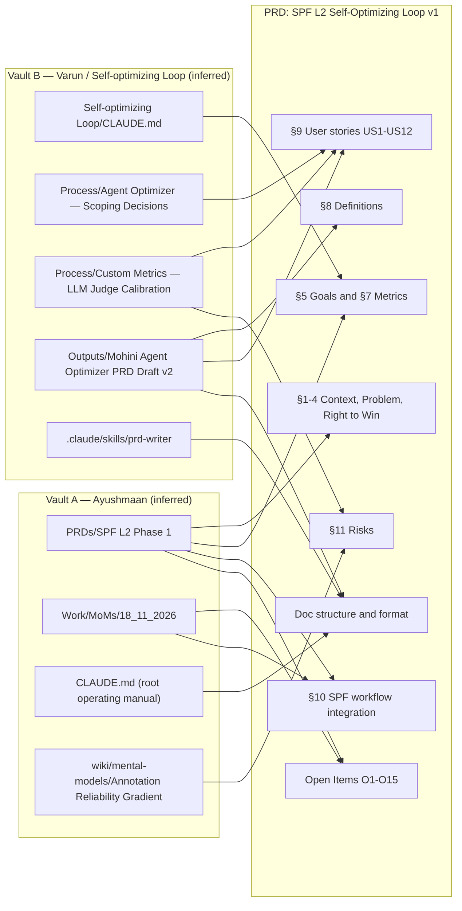

# SPF L2 Self-Optimizing Loop PRD — Source Map

Which notes fed which PRD sections. Vault origin (A / B) is **inferred** from authorship inside the notes, not from Syncthing metadata. Fix the subgraph membership if wrong.

## Edge detail

| Source | Used for |
|---|---|
| A1 SPF L2 Phase 1 | Volumes, flows, routing, acceptance targets, shadow mode, the 41-case flyer issue, `spf_flyer_status`, open conflicts (§10 integration, §1–4, O-items) |
| A2 MoM 18 Nov | SLA 3 → 6 hrs (O4); RTOCV and RVP WPR CX MM flows still open (O9) |
| A3 Root CLAUDE.md | Frontmatter, naming, "never invent numbers", confidentiality rule |
| A4 Annotation Reliability Gradient | Risk: concrete checks are more reliable than subjective ones |
| B1 Loop CLAUDE.md | Closed-loop framing, phase-by-phase scoping, causal "why it improved" |
| B2 Scoping Decisions | One cluster one fix, 3 retries, no auto-apply, rejected changes not re-proposed, conflict freeze, evidence counts not a confidence %, sims prove "doesn't break" |
| B3 Custom Metrics research | Need for human ground truth, criteria drift, different-family judge (US2, §11) |
| B4 Mohini PRD v2 | Section layout, Terms table style, FR/US/AC format, history and conflict stories (US4, US7, US12) |
| B5 prd-writer skill | Required PRD structure and Open Items table |

## Read but not used
- `Work/MoMs/19_11_2026` (Brand Assure notes, unrelated)
- `Self-optimizing Loop — Index` (navigation only)
- Vault-wide filename and keyword scan to find the above

<!-- auto-related:start (generated by _agent/scripts/link_notes.py — edits inside are overwritten) -->
## Related
- [[PRDs/SPF L2 Self-Optimizing Loop PRD Draft v1|SPF L2 Self-Optimizing Loop PRD Draft v1]]
<!-- auto-related:end -->
