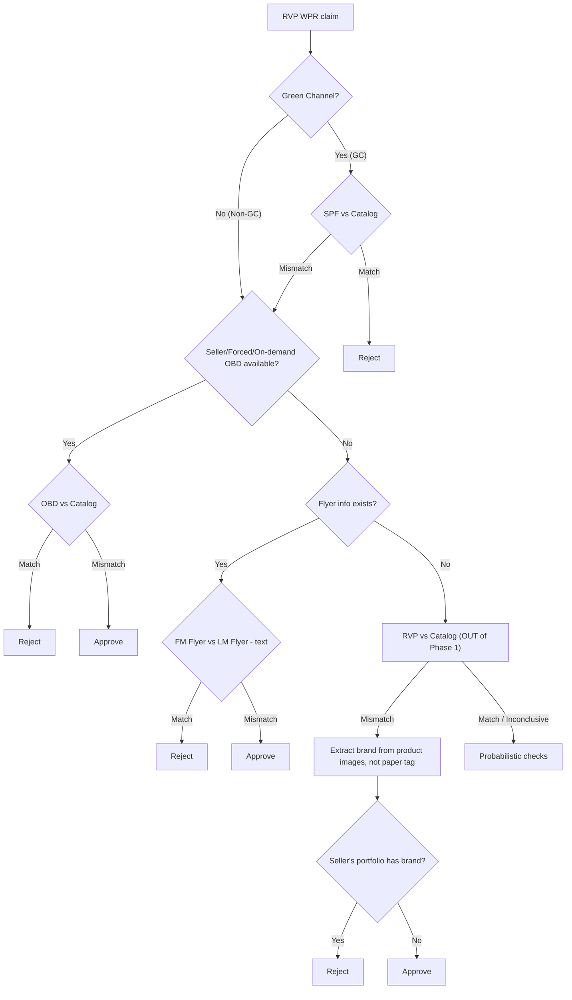
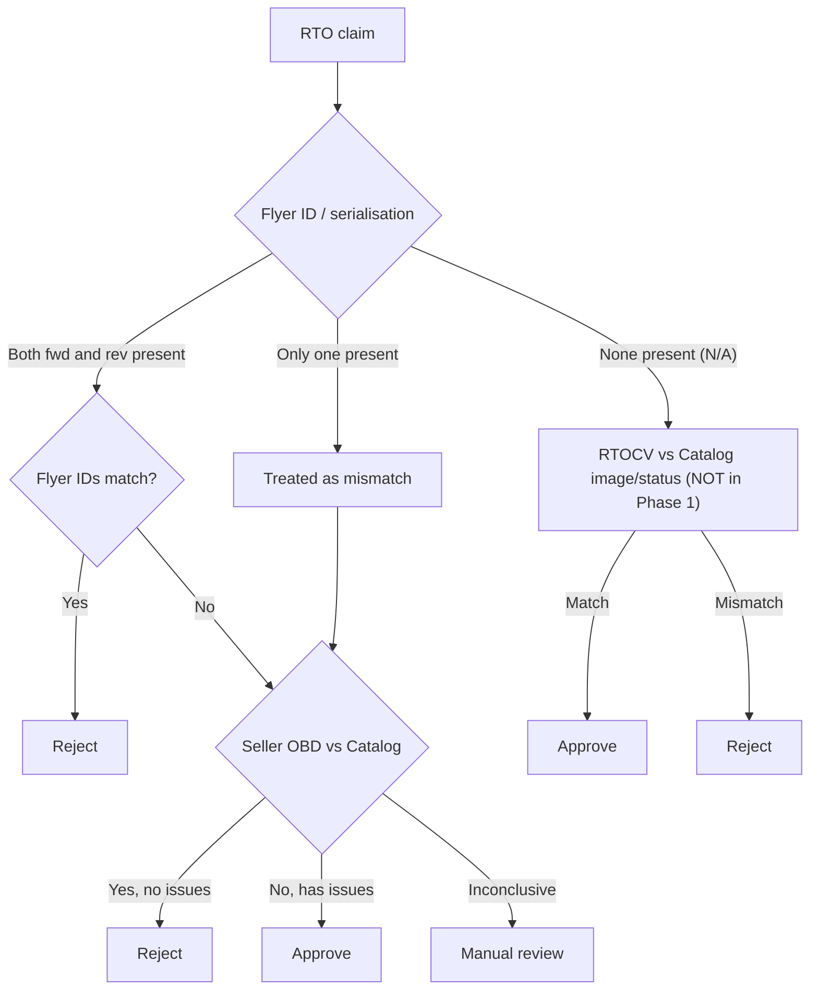
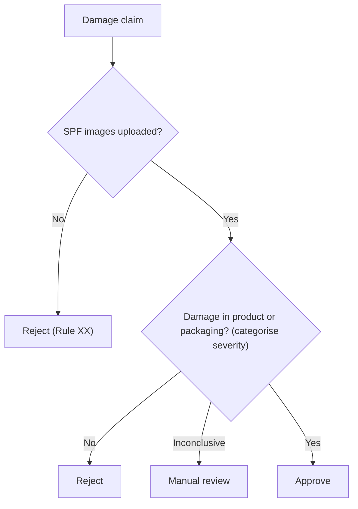

---
title: SPF L2 Claim Automation (Image Validation) – PRD
tags: [prd, spf, trust-and-safety, image-validation, ai]
status: draft
owner: Ayushmaan Pattnayak
phase: 1

# SPF L2 Claim Automation – PRD

## 1. Background

**SPF (Seller Protection Fund)** works as insurance for sellers when a returned product has a discrepancy. Examples: seller shipped A but received B, or received A but damaged.

- Sellers raise claims by submitting images.
- Human agents compare images from several supply-chain checkpoints to decide who is at fault: customer, Flipkart or seller.
- **Genuine claim** (seller not at fault): approved, cash payout.
- **Seller fault or fraud**: rejected, no payout.

### SPF stages

| Stage | Description | Owner | Scope |
|---|---|---|---|
| SPF L1 | Primary investigation | MART team | Out of scope |
| SPF L2 | Secondary, detailed investigation | Trust & Safety (TnS) | **In scope** |

### Return types

| Type | Meaning | Share of claims |
|---|---|---|
| RTO (Return to Origin) | Item not delivered: never reached the customer, or refused post-OBD | ~20–30% |
| RVP (Reverse Pickup) | Item delivered, later returned by the customer | ~70–80% |

## 2. Problem Statement

- 10,000–15,000 claims arrive daily, in morning and afternoon batches.
- Manual review at this volume is slow and inconsistent.
- There is also a risk of agent bribery.
- Human error rate is about 2–3%, so human decisions are not a perfect baseline.

## 3. Goal

Improve the **reliability and speed** of SPF L2 resolution using image validation systems that **match or exceed human accuracy**.

## 4. Current Manual Process

1. Agents use the internal tool **FMLM Task** (for both RVP and RTO).
2. For each claim, the agent fills a form of 15–17 questions.
3. The agent downloads a bulk CSV through an internal gateway.
   - The initial CSV holds all incidents.
   - Form responses are appended to the same CSV.
4. The CSV is uploaded to an **Excel macro**, which applies the SOP rules and outputs Approve or Reject.

### Form questions

> [!note]
> In the source, only the bolded questions were in scope for now. The bolding was lost, so mark the in-scope ones here.

- Actual reason for claim
- **RVP = Catalog image**
- **RVP = Seller image**
- Brand/design on RVP image is part of seller's listing/review
- Last-mile VMS video (Flyer ID latching) = Catalog
- VMS video feedback
- Seller VMS (forward video) = Catalog
- Return VMS (unpacking video) = Catalog
- Return VMS (unpacking video) = RVP
- Return VMS (unpacking video) = Seller image
- **CX OBD / CX image = RVP**
- **CX OBD / CX image = Catalog**
- Brand/design on CX OBD / CX image is part of seller's listing/review
- **Seller image = Seller OBD image**
- **Seller image = Catalog image**
- Brand/design on seller image / Seller OBD is part of seller's listing/review

Question sets differ between RVP and RTO.

## 5. Phase 1 Scope

### In scope

1. RVP where CX reason is **not Missing / not Misshipment** (WPR: Wrong Product Received).
2. **All RTO cases.**
3. **Damage cases** (HighProductDamage / LowProductDamage / PrimaryPackagingDamaged), both RVP and RTO.

### Out of scope (for now)

- RVP WPR with Missing / Misshipment (MM).
- Other RVP cases besides WPR.
- Some branches within the in-scope flows (called out in the flowcharts).
- Video-based adjudication.

### Routing logic

| Condition | Workflow |
|---|---|
| `return_type = COURIER_RETURN` | RTO |
| `return_type = CUSTOMER_RETURN` + claim code `MainProduct_WrongProductReceived` + reason not `MISSHIPMENT` / `MISSING_ITEM` | RVP / WPR |
| Claim code `PrimaryPackaging_Damaged` / `MainProduct_HighDamage` / `MainProduct_LowDamage` | Damage |

## 6. Decision Flows

### 6.1 RVP – WPR (CX reason ≠ Misshipment / Missing)

Share: see [[#12. Open Items]] (volume figures conflict).

- **Non-GC (GC = FALSE):** check seller / forced / on-demand OBD first.
- **GC (GC = TRUE):** compare SPF vs Catalog first.

> [!warning] Known issue
> 41 of 2,326 cases should have gone through the flyer ID match flow but human agents sent them to RVP vs Catalog despite a flyer being present. All 41 were approved instead of rejected, though the flyer IDs matched.

> [!note]
> RVP vs Catalog is **not deployed in Phase 1** because its volume is very low.

### 6.2 RTO

> [!note]
> RTOCV image comparison is **not deployed in Phase 1** (very low volume).

### 6.3 Damage

Applies to: `MainProduct_HighDamage`, `MainProduct_LowDamage`, `PrimaryPackagingDamaged`.

- **Primary packaging** means the product's own packaging / brand box, not Flipkart packaging. Approve only if the product packaging itself is damaged.
- **Combo cases** (e.g. 3 products, 1 damaged) and **quality disguised as damage** go to **manual review**. Confirmed with Sai Lakshmi.

## 7. Non-Functional Requirements

### Volume and SLA

| Item | Value |
|---|---|
| Daily inflow | ~10k, in 2 batches |
| Morning batch | 6k, assigned 8:00 AM |
| Noon batch | 4k, assigned 2:00 PM |
| Current manual turnaround | 4–5 hrs (morning); 5–6 PM completion (noon) |
| **Target processing time** | **3 hrs for 6k requests** |
| Why 3 hrs | Leaves TnS time for manual work on unclear cases |
| Implied delivery | Morning results by ~11 AM; noon batch well inside its window |

### Derived figures

- **Capacity:** design for 6k per batch (the larger one).
- **Throughput:** 6k in 3 hrs ≈ 2,000/hr ≈ **33/min**.
- **Images per request:** catalog and SPF 4–6, SxOBD up to 2, so up to ~8 images. A 6k batch is **~48k images max**.
- **Batching:** 2 batches/day, no overlap. The morning batch must clear before noon.
- **Manual fallback:** unclear cases must reach TnS within the 3-hr window.

### Expected daily volume mix

Figures are from the business team's recall and can vary day to day, but not widely.

| Workflow | Per day | Share |
|---|---|---|
| RTO | 3,000 | 30% |
| WPR | 5,500 | 55% |
| ↳ GC | 3,575 | |
| ↳ Non-GC | 1,925 | |
| Damage | 1,500 | 15% |
| **Total** | **10,000** | (6k morning / 4k noon) |

> [!note]
> The first split summed to 10,500 because some RTO cases moved to the WPR flow. WPR was cut from 60% to 55% to correct it.

### Not yet defined (confirm)

- Accuracy or auto-decision rate targets
- Availability and retry behaviour on batch failure
- Audit and logging requirements
- Peak-day multiplier beyond 6k

## 8. Acceptance Criteria

| Check | Accuracy | Recall |
|---|---|---|
| SPF vs Catalog | > 90% | > 85% |
| Seller OBD vs Catalog | > 85% | > 80% |

## 9. Go-To-Market

Because human reviewers also err (~2–3%), the AI cannot be judged against a perfect baseline.

1. **Shadow mode** for the first few weeks to months.
2. Set up **observability dashboards** comparing AI decisions with human decisions on live production claims.
3. Use the results to establish a baseline and decide whether the AI is good enough to take over decisions.

## 10. Decisions and Clarifications

### Testing

- Test the new flows for both WPR categories (RTO and RVP).
- Analyse outcomes, with the **confusion matrix** as a key part of the review.

### Decisions

1. **SPF L1 rejections** don't reach TnS. Only Approved and Detailed Investigation (DI) cases go to TnS.
2. **SPF vs Catalogue** is done only in SPF Non-GC today. SPF GC goes straight to TnS without it. **Action:** build SPF vs Catalogue into the GC flow.
3. **No simple/complex split** between L1 and L2. Everything not rejected at L1 moves to L2.
4. **Damage cases are out of scope for MART (SPF L1).** Ensure L1 teams stop picking them up.
5. **SPF vs Catalogue approach:** carry forward whichever approach performs better. Connect with stakeholders after the MART discussion, then schedule a call.
6. **MART Non-GC mismatches:** of cases MART marks Mismatch in Non-GC, 0.24% (4/650) get rejected because of Match Reason. Consume MART outputs.
7. Everything else: no changes.

### `spf_flyer_status` logic

| Condition | Status |
|---|---|
| Both flyers present, strings match | `verified` |
| Both flyers present, strings differ | `mismatch` |
| One flyer present, other absent | `skipped` |
| Neither present | `blank` |

### Implementation notes (AIS team)

- With only one flyer ID present, it is marked a flyer ID mismatch, for uniformity.
- `SPF_Cat` is marked **Mismatch for all Non-GC (RVP)** with no actual image comparison. Engineering, Product and TnS agreed on this.
- The **Traces** column in the output sheet shows how the model processed each incident ID.
  - Example: if an OBD image link is present but broken or empty at processing time, the model falls back to the flyer ID APIs.

## 11. Q&A Log

| Question | Answer |
|---|---|
| Can we get more metadata from the OMS API? (Google's ask) | Yes. |
| Top categories to focus on? | Lifestyle. |
| What is the difference between Seller OBD image and RVP image? | Seller OBD image: taken by the Wishmaster when delivering the product to the seller. RVP image: taken when the product is dispatched back to the seller. |
| How many of the 10k daily claims are resolved today? | Almost all, but not within the target SLA. |
| What is a Flyer ID? | ID of the plastic packaging. |
| Is Seller OBD Remarks mandatory? | Yes, wherever Seller OBD is done. |
| Who determines "Actual Reason for Claim"? | **Open.** If humans set it after the comparisons, it's not usable as upfront context. If sellers provide it, it can serve as metadata / LLM context. |
| Combo and "quality disguised as damage" handling? | Manual review (confirmed with Sai Lakshmi). |

## 12. Open Items

- [ ] **Volume conflict:** the flows say WPR 25–30%, RTO 25% and Damage 25%. The NFR mix says WPR 55%, RTO 30% and Damage 15%. Confirm the NFR mix as the source of truth.
- [ ] **Item 7 figure:** 4/650 ≈ **0.62%**, not 0.24%. Confirm which is correct.
- [ ] **Flyer logic:** the `spf_flyer_status` table says one flyer present = `skipped`, but the notes say it's marked as a flyer ID mismatch. Clarify which applies where.
- [ ] **GC / Non-GC naming:** the flow does SPF vs Catalog in GC, but decision 2 says SPF vs Catalogue exists only in Non-GC today. Confirm.
- [ ] **Damage ownership:** damage is in Phase 1 scope but "out of scope for MART". Confirm how L1 is prevented from picking these up.
- [ ] Mark the in-scope form questions (bolding lost).
- [ ] Define accuracy / auto-decision targets, retry and availability behaviour, audit and logging, and the peak-day multiplier.
- [ ] Who sets "Actual Reason for Claim", and at what stage?

## 13. Future Scope

- **Video-based adjudication** for SPF claims.
- **Niche models** for the complex cases that automation leaves behind.
- **Merge SPF L1 and L2** into one stage. Long-term, and only after discussion with the MART team.

<!-- auto-related:start (generated by _agent/scripts/link_notes.py — edits inside are overwritten) -->
## Related
- [[PRDs/SPF L2 Self-Optimizing Loop PRD Draft v1|SPF L2 Self-Optimizing Loop PRD Draft v1]]
- [[Self-optimizing Loop/Outputs/Auto Evals Phase 2 - PRD Draft v1|Auto Evals Phase 2 - PRD Draft v1]]
- [[Self-optimizing Loop/Outputs/Auto Evals Phase 2 - PRD Approved Buildout|Auto Evals Phase 2 - PRD Approved Buildout]]
<!-- auto-related:end -->
